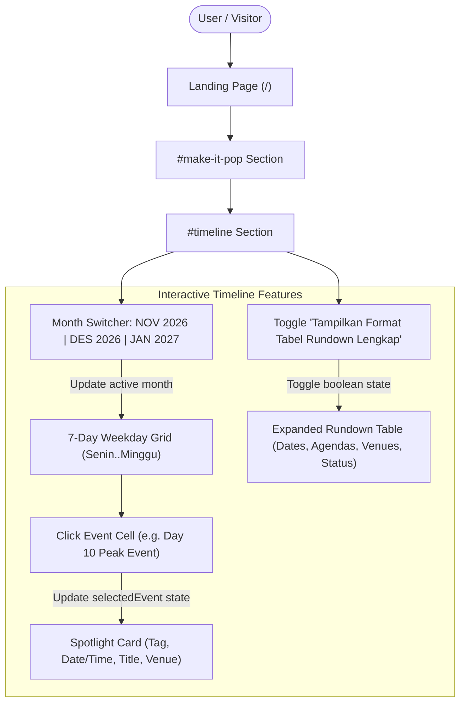

# CAKFEST VOL.2 - Settings, API Contract & System Flow
## Component 1: "Make It Pop" Brand Pillars & Dynamic Routing
## Component 2: "Kalender Timeline & Acara Resmi" (Interactive Event Calendar)

This document defines the configuration, data contracts, and interaction flows for the **"Make It Pop"** and **"Kalender Timeline & Acara Resmi"** sections of the Cakrawala Festival (CAKFEST) VOL.2 website. It serves as the single source of truth for frontend developers and backend engineers integrating CMS/API data services.

---

## 1. Settings & Environment

### Frontend Environment
- **Framework**: React 19 + TypeScript
- **Bundler**: Vite 8 with `@vitejs/plugin-react`
- **Styling**: Tailwind CSS v4 (`@tailwindcss/vite`)
- **Routing**: `react-router-dom` v7 with dynamic segment routes (`/pillars/:slug`)

### Configuration & Path Mapping
| Variable / Asset | Source / Default | Description |
|---|---|---|
| `BASE_URL` | `/` | Base route of the landing application |
| `FONTS_DIR` | `/public/fonts` | Local brand font files (Amoresa, Aileron, Vanosky, PlanetKosmos) |
| `PILLAR_DATA_SOURCE` | `src/lib/data/Visisection.ts` | Local typed contract & JSON dataset for 4 pillars |
| `TIMELINE_DATA_SOURCE` | `src/lib/data/timelineData.ts` | Local typed contract & JSON dataset for calendar & rundown |
| `DEV_SERVER_PORT` | `5173` (default) | Local development Vite server |

### Typography Design System Mapping (Aligned with Reference Site)
| Role / Element | Font Family | Fallback / Source | Applied Locations |
|---|---|---|---|
| **Section Headings** | `'Aileron', sans-serif` (weight: 900 / black) | `var(--font-vanosky)`, local `@font-face` / cdnfonts | `Make It Pop` header, `Kalender Timeline` header |
| **Pillar Card Titles** | `'Space Grotesk', sans-serif` (weight: 800) | Google Fonts (`Space Grotesk`) | 4 Pillar cards (*Collaborative*, *Creative*, etc.) |
| **Body / Paragraphs** | `'Aileron', sans-serif` (weight: 400 - 500) | `var(--font-body)`, local `@font-face` | Subtitles, pillar descriptions, event descriptions |
| **Calendar Nav & Tabs** | `'Aileron', sans-serif` (weight: 800 - 900) | `var(--font-display)` | `JANUARI 2027 ★ PEAK`, `NOV 2026`, `DES 2026`, `JAN 2027` |
| **Weekday Headers** | `'Aileron', sans-serif` (weight: 800) | `var(--font-display)` | `SENIN`, `SELASA`, `RABU`, `KAMIS`, `JUMAT`, `SABTU`, `MINGGU` |
| **Numeric & Dates** | `'JetBrains Mono', monospace` (weight: 700 - 800) | `var(--font-mono)`, Google Fonts | Calendar cell day numbers (`1` - `31`), event times, timetable dates |
| **Event Mini Titles** | `'Aileron', sans-serif` (weight: 800) | `var(--font-display)` | Day 8, 9, 10 event titles inside calendar cells |
| **Event Mini Venues** | `'JetBrains Mono', monospace` (weight: 700) | `var(--font-mono)` | Venue tags (`📍 GOR & Hall Utama`) |
| **Spotlight Card Deck** | `'Aileron', sans-serif` (title: 900, desc: 400) | `var(--font-display)` & `var(--font-body)` | `PUNCAK FESTIVAL (PEAK)`, `Grand Final & Awarding Night` |
| **Display Font Token** | `'Amoresa', sans-serif` (weight: 700) | `/public/fonts/Amoresa.woff2` | Available via `var(--font-amoresa)` |

---

## 2. API & Data Contract (Backend Readiness)

Presentation is strictly decoupled from data. Backend engineers can provide endpoints matching the following specifications:

### 2.1 GET /api/pillars (Retrieve All Pillars)
- **HTTP Method**: `GET`
- **Endpoint**: `/api/pillars` (or `/api/v1/content/make-it-pop`)
- **Headers**: `Accept: application/json`
- **Response Schema** (HTTP 200 OK):
```json
{
  "sectionId": "make-it-pop",
  "eyebrowTag": "CAKFEST VOL.2 // 4 PILAR PENGGERAK",
  "titlePrefix": "MAKE IT POP:",
  "titlePopHighlight": "TURN YOUR SPARK",
  "titleImpactHighlight": "INTO IMPACT",
  "tagline": "Your Spark. Your Moment. Your Impact.",
  "summary": "Cakfest Vol.2 memadukan 4 pilar penggerak untuk menciptakan wadah kolaborasi, ruang kreativitas, dan kompetisi bergengsi bagi generasi muda se-Indonesia.",
  "pillars": [
    {
      "id": "pillar-1",
      "slug": "collaborative",
      "title": "Collaborative",
      "shortDescription": "Wadah persaudaraan, jejaring positif, dan kerja sama suportif antarmahasiswa dan pelajar nusantara.",
      "iconType": "collaborative",
      "badgeTag": "PILAR 01 // SINERGI",
      "themeColor": {
        "primary": "#38bdf8",
        "secondary": "#f6feff",
        "glow": "rgba(56, 189, 248, 0.25)",
        "border": "rgba(246, 254, 255, 0.4)",
        "badgeBg": "rgba(25, 34, 113, 0.6)"
      }
    }
  ]
}
```

### 2.2 GET /api/pillars/:slug (Retrieve Single Pillar Details)
- **HTTP Method**: `GET`
- **Endpoint**: `/api/pillars/:slug`
- **Path Parameters**: `slug` (string, required)

---

### 2.3 GET /api/timeline (Retrieve Timeline & Calendar Schedule)
- **HTTP Method**: `GET`
- **Endpoint**: `/api/timeline` (or `/api/v1/calendar/schedule`)
- **Headers**: `Accept: application/json`
- **Query Parameters (Optional)**:
  - `month`: Filter events by specific month (`YYYY-MM`, e.g. `2027-01`)
- **Response Schema** (HTTP 200 OK):
```json
{
  "sectionId": "timeline",
  "title": "KALENDER TIMELINE & ACARA RESMI",
  "subtitle": "Jadwal pelaksanaan Cakfest Vol.2 dalam format kalender interaktif. Cek tanggal, nama kegiatan, dan lokasi pelaksanaan di setiap etape festival.",
  "months": [
    {
      "key": "2026-11",
      "label": "NOVEMBER 2026",
      "shortLabel": "NOV 2026",
      "year": 2026,
      "monthIndex": 10,
      "totalDays": 30
    },
    {
      "key": "2026-12",
      "label": "DESEMBER 2026",
      "shortLabel": "DES 2026",
      "year": 2026,
      "monthIndex": 11,
      "totalDays": 31
    },
    {
      "key": "2027-01",
      "label": "JANUARI 2027 ★ PEAK",
      "shortLabel": "JAN 2027",
      "year": 2027,
      "monthIndex": 0,
      "totalDays": 31
    }
  ],
  "events": [
    {
      "date": "2027-01-08",
      "dayNumber": 8,
      "title": "Opening & Babak 1/4 Final",
      "venue": "GOR & Hall Utama",
      "time": "Jumat, 08 Jan 2027 // 08.00 - 18.00 WIB",
      "tag": "HARI KE-1: KICK OFF",
      "type": "match",
      "desc": "Upacara pembukaan Cakfest Vol.2, defile kontingen, dan kick-off pertandingan perempat final semua cabang kompetisi."
    },
    {
      "date": "2027-01-09",
      "dayNumber": 9,
      "title": "Semifinal & Dance Showcase",
      "venue": "Main Stage Kampus",
      "time": "Sabtu, 09 Jan 2027 // 09.00 - 19.30 WIB",
      "tag": "HARI KE-2: SEMIFINAL",
      "type": "match",
      "desc": "Pertandingan semifinal penentuan tiket partai puncak, panggung parade festival band, dan showcase tari kreasi."
    },
    {
      "date": "2027-01-10",
      "dayNumber": 10,
      "title": "Grand Final & Awarding Night",
      "venue": "Panggung Spektakuler Cakfest",
      "time": "Minggu, 10 Jan 2027 // 13.00 - 22.00 WIB",
      "tag": "PUNCAK FESTIVAL (PEAK)",
      "type": "peak",
      "desc": "Pertarungan grand final seluruh cabang lomba, penganugerahan Piala Bergilir Rektorat, konser bintang tamu spektakuler, dan malam penganugerahan juara."
    }
  ],
  "rundown": [
    {
      "id": "rd-1",
      "dateRange": "01 Okt - 30 Nov 2026",
      "agenda": "Pendaftaran Gelombang 1 (Batch 1) Seluruh Cabor",
      "venue": "Online via Website Resmi",
      "status": "SEDANG BERJALAN",
      "isAccent": true
    },
    {
      "id": "rd-6",
      "dateRange": "10 Jan 2027",
      "agenda": "Grand Final & Awarding Ceremony Night",
      "venue": "Panggung Spektakuler Cakfest Vol.2",
      "status": "PUNCAK ACARA",
      "isAccent": true
    }
  ]
}
```

---

## 3. Interaction & Routing Flow



### Detailed Interaction Sequences:
1. **Default Load**:
   - `selectedMonthKey` defaults to `2027-01` (matching screenshot peak month).
   - `selectedEvent` defaults to `2027-01-10` (*Grand Final & Awarding Night*).
   - Cell `10` renders with neon lime glowing border (`#e0ff00`).
   - Spotlight deck displays the magenta badge `PUNCAK FESTIVAL (PEAK)`, lime date/time, bold title, and venue box.
2. **Month Navigation**:
   - Clicking `<` or `>` transitions backward or forward between months (`NOV 2026` ↔ `DES 2026` ↔ `JAN 2027`).
   - Clicking month pills updates `selectedMonthKey` and auto-selects the first event in that month.
3. **Event Selection**:
   - Clicking any calendar cell containing an event immediately highlights that cell with the neon lime glowing border and updates the spotlight deck.
4. **Collapsible Rundown Table**:
   - Clicking `Tampilkan Format Tabel Rundown Lengkap` expands the table below with all 6 event milestones and status pills.

---

## 4. Data Layer & Validation

- **Locations**:
  - `src/lib/data/Visisection.ts`: Pillars data contract.
  - `src/lib/data/timelineData.ts`: Calendar & rundown data contract.
- **Type Interfaces**:
  - `CalendarMonth`: Key, label, shortLabel, year, monthIndex, totalDays.
  - `CalendarEvent`: Date, dayNumber, title, venue, time, tag, type, desc.
  - `RundownItem`: Id, dateRange, agenda, venue, status, isAccent.
  - `TimelineSectionConfig`: Full section configuration.
- **Safety**:
  - Boundary guards for `currentMonthIndex` prevent out-of-range navigation.
  - Fallback defaults prevent `undefined` crashes if an event is unselected.

---

## 5. Security & Privacy

- **Client-Side Sanitization**: All content rendered via safe React JSX expressions, preventing XSS vulnerabilities.
- **No Sensitive Data**: Public event schedule and marketing copy only. No internal administrative endpoints or credentials exposed.
- **CSRF & Injection Safe**: Pure frontend presentation component with no unsafe `dangerouslySetInnerHTML`.

---

## 6. Operations & Maintenance

- **Build Tooling**: `npm.cmd run build` executes `tsc -b` and `vite build` without errors.
- **Linting**: `npm.cmd run lint` executes ESLint with 0 errors and 0 warnings.
- **Responsive Layout**: Overflow horizontal scroll wrapper ensures clean layout on mobile screens (< 768px).
- **Background Asset**: Deep cosmic background with halftone star is maintained across all sections.

